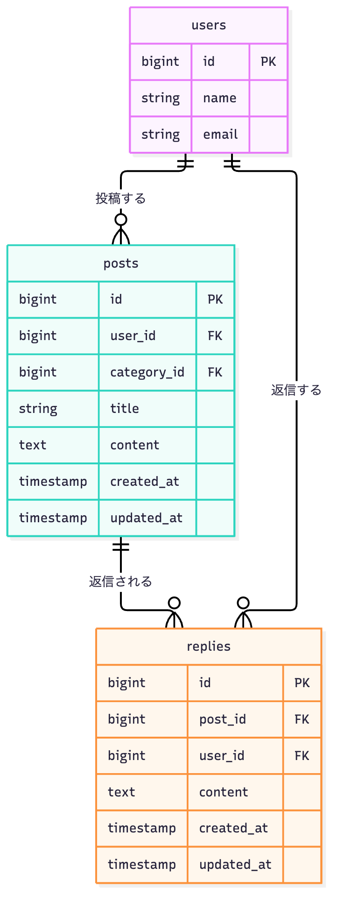
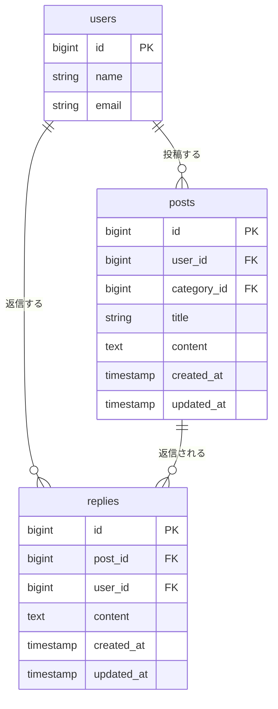

> この設計書は、この機能を実装した時点の記録です。このあとは更新していません。

# リプライ機能 設計書

GitHub Issue #1「ポストにリプライ機能を追加する」の設計。実装コードはこの文書では扱わない。

## 概要

今は投稿を読むだけで、返す手段がない。ポストを読んだ人がその場で一言返せるように、リプライ機能を足す。

- ポスト詳細ページを新設し、そのポストとリプライの一覧を表示する
- 詳細ページからリプライを送信できる
- 自分のリプライは削除できる。削除できるのはリプライ投稿者本人のみで、判定は `app/Policies/PostPolicy.php` と同じやり方（`$user->id === 対象の user_id`）に揃える
- ポストを削除したら、そのポストのリプライも一緒に削除する
- 今回やらないこと: リプライへのリプライ（入れ子）、リプライの編集、リプライ件数のタイムライン表示、ポスト投稿者による他人のリプライの削除

### 決めたこと

| 論点 | 決定 |
| :--- | :--- |
| 詳細ページへの入口 | タイムラインの各ポストに「返信」リンクを 1 つ足す |
| 本文の文字数上限 | 140 文字（ポスト本文と同じ） |
| 並び順 | 新しい順 |
| ポスト削除時のリプライ | 一緒に削除する |

## 受け入れ条件

- [ ] ポストを 1 件開くと、そのポストとリプライの一覧が見える
- [ ] 本文を入れてリプライを送ると、一覧に増える
- [ ] 本文が空のままだと、エラーが表示されてリプライは増えない
- [ ] 自分のリプライは消せて、他人のリプライは消せない

## 変えないもの

- タイムライン（`/posts`）の今の動き（一覧・編集・削除）と並び順
  - 唯一の追加は、各ポストへの「返信」リンク 1 つ。既存の編集・削除ボタンの表示条件と並びは変えない
- ポストの編集・削除の認可（`PostPolicy` は変更しない）
- ポスト本文のバリデーションとメッセージ
- ログイン・登録（Fortify）まわり
- `AuthServiceProvider::$policies` は空のまま（`ReplyPolicy` もモデル名からの自動検出に任せる）
- ポストを削除する操作は、リプライが付いていても今まで通り成功する

## 増えるテーブル

### replies（リプライ）

| カラム名 | データ型 | 制約 | 説明 |
| :--- | :--- | :--- | :--- |
| id | BIGINT | PRIMARY KEY, AUTO_INCREMENT | リプライを 1 件ずつ区別する番号 |
| post_id | BIGINT | NOT NULL, FOREIGN KEY（`posts.id`、削除時カスケード） | 返信先のポスト |
| user_id | BIGINT | NOT NULL, FOREIGN KEY（`users.id`、削除時カスケード） | リプライの投稿者 |
| content | TEXT | NOT NULL | リプライの本文（140 文字以内） |
| created_at | TIMESTAMP | - | 投稿した日時 |
| updated_at | TIMESTAMP | - | 更新した日時 |

- `post_id` / `user_id` とも削除時はカスケード（`posts.user_id` と同じ方式）。ポストまたはユーザーが消えると、そのリプライも消える
- 新しい順の表示に使うので、並びは `created_at` の降順（同時刻の入れ替わりを避けるため `id` 降順を併用する）

### ER 図

図の元になる Mermaid（編集用。変更したら `reply-er.png` も書き出し直す）:

今回増えるのは `replies` だけ。図には、`replies` が参照する既存の `users`（`user_id`）と `posts`（`post_id`）を並べている。この 2 つと、図に出していない `categories` は変更しない。

## 増える画面

### ルート

すべて既存と同じく `auth` ミドルウェアのグループ内。未ログインはログイン画面へリダイレクトされる。

| 画面・操作 | メソッド・パス | 認可 | 成功時 |
| :--- | :--- | :--- | :--- |
| ポスト詳細（ポスト + リプライ一覧 + 送信フォーム） | `GET /posts/{post}` | ログイン済みなら誰でも | 詳細ページを表示 |
| リプライ送信 | `POST /posts/{post}/replies` | ログイン済みなら誰でも | 詳細ページへ戻る（一覧に増える） |
| リプライ削除 | `DELETE /replies/{reply}` | 投稿者本人のみ（`ReplyPolicy::delete`）、他人は 403 | 詳細ページへ戻る |

### ポスト詳細ページ

上から次の順に並べる。

1. ヘッダー（既存画面と同じ見た目）
2. 対象ポスト（投稿者名・日時・カテゴリ・タイトル・本文）
3. リプライ送信フォーム（本文の入力欄と送信ボタン。入力エラーはここに表示する）
4. リプライ一覧（新しい順）
   - 各リプライに投稿者名・投稿日時・本文を表示する
   - 自分のリプライにだけ「削除」ボタンを出す（`@can('delete', $reply)`）
   - 0 件のときは空状態のメッセージを出す

### 既存画面の変更（タイムライン）

- 各ポストに「返信」リンクを 1 つ追加し、`GET /posts/{post}` へ遷移させる。それ以外は変更しない

## 入力チェックとメッセージ一覧

### リプライ本文

| 項目 | ルール | 備考 |
| :--- | :--- | :--- |
| content | 必須、文字列、140 文字以内 | 検証前に改行の CRLF を LF にそろえてから数える（`PostController::update` と同じ扱い） |

- バリデーションはコントローラ内の `$request->validate()`（FormRequest は使わない）
- エラー時は詳細ページに戻り、リプライは増えない。入力した本文は入力欄に残す

### メッセージ

| 場面 | 種別 | メッセージ・結果 |
| :--- | :--- | :--- |
| 本文が未入力 | 入力エラー | 本文を入力してください。 |
| 本文が 141 文字以上 | 入力エラー | 本文は140文字以内で入力してください。 |
| 他人のリプライを削除しようとした | 認可エラー | 403（Laravel 標準の画面） |
| 未ログインでアクセスした | 認証エラー | ログイン画面へリダイレクト |
| 存在しないポスト・リプライを指定した | 該当なし | 404（Laravel 標準の画面） |

## テスト観点

`tests/Feature/` に追加する。

### 表示

- 詳細ページに、そのポストのリプライだけが新しい順で表示される（他ポストのリプライは出ない）
- リプライが 0 件のポストでは、空状態のメッセージが出る
- 自分のリプライにだけ削除ボタンが出る（他人のリプライには出ない）
- タイムラインの各ポストに「返信」リンクが出る

### 送信

- 本文ありで送信すると `replies` が 1 件増え、一覧に出る
- 本文が空だとエラーメッセージが表示され、件数は増えない
- 140 文字ちょうどは成功し、141 文字はエラーになる
- 改行を含む本文は、CRLF を LF として数える（改行 1 つ = 1 文字）

### 削除・認可

- 自分のリプライを削除すると消える
- 他人のリプライを削除すると 403 になり、件数は変わらない
- ポスト投稿者であっても、他人のリプライは削除できない
- 未ログインでは、詳細・送信・削除のいずれもログイン画面へリダイレクトされる

### 既存の動きが変わっていないこと

- リプライ付きのポストを削除しても、エラーにならずリプライも一緒に消える
- ユーザーを削除すると、そのユーザーのリプライも消える
- 既存の `PostUpdateTest` が引き続き通る
